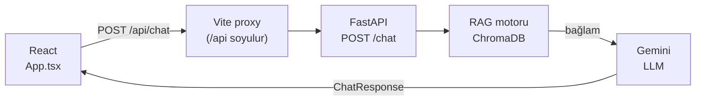

# 🍳 ŞefBot

**Türk mutfağının 3.320 tarifini bilen, uydurmayan bir yemek asistanı.**

"Akşama ne pişirsem?" sorusunun cevabı genelde ya bir arama motorunun reklam tarlasında ya da tarifin altındaki 40 paragraflık anı yazısında kaybolur. ŞefBot bunu bir sohbete indirger: ne canınız çektiğini söylersiniz, size elindeki tariflerden birkaç seçenek sunar, birini seçersiniz, tarifi önünüze koyar.

Farkı da tam burada: **elindeki tariflerden.** ŞefBot bir dil modelinin hafızasından tarif uydurmaz.

---

## Neden "uydurmuyor" bir özellik?

Bir dil modeline "Çerkez Tavuğu tarifi ver" derseniz, size akıcı ve kendinden emin bir tarif yazar. Malzemeler makul görünür, adımlar mantıklıdır. Ama o miktarlar hiçbir yerden gelmez — model onları üretir. Mutfakta bu, çöpe giden bir akşam yemeği demektir.

ŞefBot her yanıtı gerçek bir tarif veritabanına dayandırır (RAG — Retrieval-Augmented Generation). Sorunuz önce anlamsal olarak aranır, bulunan tarifler modele bağlam olarak verilir, model yalnızca o metinden konuşur. Aradığınız tarif veri setinde yoksa uydurmaz, olmadığını söyler:

> **Siz:** California roll sushi tarifi verir misin
>
> **ŞefBot:** Türk mutfağının nefis lezzetleri arasında ne yazık ki aradığınız California roll sushi tarifi bulunmuyor. Elimizde harika ana yemekler ve enfes tatlılar var; dilerseniz onlara bir göz atabiliriz.

Tam eşleşme bulamadığında da dürüst davranır — farkı söyler, en yakınını önerir:

> **Siz:** Kelle paça çorbası nasıl yapılır
>
> **ŞefBot:** Doğrudan kelle paça çorbası dökümanı olmasa da, enfes bir alternatifi olan **Yalancı Kelle Paça Çorbası** tarifini paylaşabilirim!

---

## Nasıl bir sohbet?

İki modu var ve aralarında kendiliğinden geçiş yapar.

**1. Öneri listesi** — ne istediğinizi genel söylediğinizde:

> **Siz:** tavuklu bir yemek yapmak istiyorum
>
> **ŞefBot:**
> 1. **Fırında Tavuk Tava** — Sebzelerle harmanlanmış, fırında lokum gibi pişen nefis bir ana yemek.
> 2. **Tavuklu Hünkar Beğendi** — Klasik beğendi lezzetinin tavuk sote ile buluştuğu eşsiz bir tarif.
> 3. **Çerkez Tavuğu** — Ceviz ve baharatların uyumuyla hazırlanan geleneksel bir lezzet.
>
> Hangisini istersiniz?

**2. Tarif kartı** — birini seçtiğinizde. Numara yazabilir ("2"), sıra sözcüğü kullanabilir ("üçüncü"), adını yazabilir ya da arayüzdeki seçim çipine tıklayabilirsiniz. Karşınıza süre/zorluk/yöntem satırı, malzeme listesi ve numaralı yapılış adımlarıyla düzenli bir tarif gelir — hepsi veritabanındaki kayıttan.

### Arayüzde neler var

- 💬 **Çoklu sohbet oturumu** — kenar çubuğundan geçmiş sohbetlere dönme
- ⭐ **Favoriler** — beğendiğiniz tarifleri oturum boyunca ayrı bir panelde toplama
- 🎨 **Tek renkten türeyen tema** — bir ana renk seçersiniz, tüm palet ondan hesaplanır
- 🌾 **Ayarlanabilir arka plan deseni** — yoğun / hafif / kapalı
- 📱 **Mobil uyumlu**, kütüphanesiz el yazımı CSS

---

## Teknik

### Mimari

İki bağımsız uygulama:

| | Klasör | Teknoloji |
|---|---|---|
| **Backend** | `backend/` | FastAPI · ChromaDB · sentence-transformers |
| **Frontend** | `frontend/` | React 18 · TypeScript · Vite |

### İstek akışı



Kullanıcı mesajı önce `intfloat/multilingual-e5-small` ile vektöre çevrilir, ChromaDB'de anlamsal arama yapılır, bulunan tarif metinleri sistem promptuyla birlikte Gemini'ye bağlam olarak verilir. Yanıt `answer` + `sources` olarak döner; arayüz kaynakları da gösterebilir.

### Kurulum

**Gereksinimler:** Python 3.11+, Node 18+, bir [Gemini API anahtarı](https://aistudio.google.com/apikey) (ücretsiz katman yeterli).

**Backend** — `backend/` içinden çalıştırın, importlar `app.*` mutlak yolunu kullanır:

```bash
cd backend
python -m venv venv && source venv/bin/activate
pip install -r requirements.txt
cp .env.example .env          # GEMINI_API_KEY değerini girin
uvicorn app.main:app --reload # http://localhost:8000 · /docs
```

**Frontend:**

```bash
cd frontend
npm install
npm run dev                   # http://localhost:5173
```

> **Not:** İlk `/chat` isteği embedding modelini indirip belleğe alır, bu yüzden ilk yanıt yavaştır (~10-20 sn). Sonrakiler hızlıdır.

### Veri yükleme

⚠️ **Vektör veritabanı bu repoda yer almaz** (boyut nedeniyle `.gitignore`'da). Depoyu klonladığınızda `backend/data/sample_tarifler.json` içinde 5 kayıtlık bir örnek set bulursunuz; koleksiyon boşken `/chat` bir `warning` alanıyla döner.

Kendi tariflerinizi yüklemek için:

```bash
cd backend
python vector_db_builder.py data/sample_tarifler.json
# veya
python -m app.ingestion_service data/sample_tarifler.json
```

Kabul edilen biçimler: JSON kök listesi, `{"chunks": [...]}` veya `text|content|chunk|body` sütunlu CSV. `text` alanı yoksa ama `tarif_adi` varsa Türkçe tek parça metin sentezlenir. ID verilmezse metnin sha256'sından türetilir ve `upsert` kullanılır — **aynı dosyayı tekrar yüklemek idempotenttir.**

### Yapılandırma

`.env` üzerinden (tamamı isteğe bağlı, `GEMINI_API_KEY` hariç):

| Değişken | Varsayılan | Açıklama |
|---|---|---|
| `GEMINI_API_KEY` | — | **Zorunlu.** Anahtar yoksa `/chat` hata döner |
| `GEMINI_MODEL` | `gemini-3.5-flash-lite` | Ücretsiz katman kotası için seçildi |
| `LLM_MAX_TOKENS` | `2048` | Düşünme token'larını da kapsar |
| `LLM_REASONING_EFFORT` | `low` | `none` … `high` |
| `APP_CHROMA_PERSIST_DIR` | `./turkish_cuisine_db` | `APP_` öneki bilinçli, ortam değişkeni çakışmasını önler |
| `APP_CHROMA_COLLECTION_NAME` | `turkish_cuisine` | Ingestion ve API aynı değeri kullanmalı |
| `EMBEDDING_MODEL` | `intfloat/multilingual-e5-small` | Ingestion ve API aynı modeli kullanmalı |
| `DEFAULT_TOP_K` | `5` | Getirilecek tarif sayısı (1-50) |
| `CORS_ORIGINS` | — | Virgülle ayrılmış liste veya `*` |

Hız sınırı: IP başına dakikada 20 istek (slowapi).

---

## Tasarım kararları

Bu projede birkaç karar bilinçli olarak alındı; kodda ilk bakışta tuhaf görünen yerlerin sebebi genelde bunlar.

**Sahte yanıt üreten mock sağlayıcı yok.** API anahtarı eksikse ya da sağlayıcı hata verirse uydurma bir cevap dönmez; hata `/chat`'ten okunur bir mesajla gelir ve arayüzde sohbet balonunda görünür. Bir RAG asistanında "sessizce çalışıyormuş gibi yapmak" en kötü hata modudur.

**Model seçimi kotayla belirlendi.** `gemini-3.5-flash-lite` ücretsiz katmanda günde 500 istek verirken tam Flash modelleri yalnızca 20 veriyor. Bağlayıcı sınır token değil, günlük istek sayısı — bu yüzden `top_k=5` ile ~4.200 token'lık bağlam gönderilmesi sorun değil.

**E5 önek sözleşmesi.** Doküman metni veritabanına ham yazılır; önek yalnızca embedding üretilirken eklenir — ingestion `passage: `, sorgu `query: ` kullanır. Ölçüldüğünde bu, öneksiz aramaya göre tutarlı biçimde daha iyi sonuç veriyor. Yeni bir yazma yolu eklenirken bu iki fonksiyonun dışına çıkılırsa geri getirme kalitesi sessizce bozulur.

**Seçim de aramadan geçer.** Kullanıcı "2" yazdığında bu metinle arama yapmak anlamsızdır — ama aramayı büsbütün atlamak tarifi modelin belleğine bırakır ve uydurma malzemeler doğurur. Bunun yerine seçim önce önceki listedeki tarif adına çözülür, arama o adla yapılır. Çözülen ad modele de bildirilir; aksi halde bağlamdaki tarifler listedeki sırayla aynı olmadığı için model yanlış tarifi anlatır.

**Bloklayan her çağrı thread'e taşınır.** `encode`, Chroma sorgusu ve ingestion `asyncio.to_thread` ile sarmalanır, olay döngüsü kilitlenmez.

---

## Bilinen sınırlar

- **Test yok.** Projede test paketi ve koşucusu bulunmuyor.
- **Sohbet oturumları ve favoriler kalıcı değil** — yalnızca bellekte tutulurlar, sayfa yenilendiğinde kaybolur. Kalıcı olan tek şey tema tercihleridir (`localStorage`).
- **Üretim derlemesinde proxy yok.** Vite proxy'si yalnızca geliştirme sunucusunda çalışır; deploy ederken `/api` yönlendirmesini bir ters vekil sunucuyla sağlayın ya da istek URL'ini değiştirin.
- Geçmiş penceresi son 8 mesajla sınırlıdır.

---

## Lisans

MIT — ayrıntılar için [LICENSE](LICENSE).
