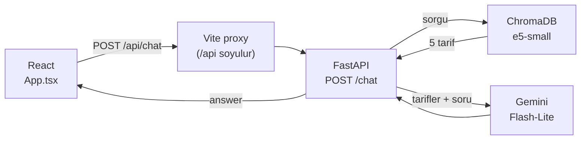

# 🍳 ŞefBot

**Türk mutfağından 3.320 tarifi bilen ve tarif uydurmayan bir yemek asistanı.**

Canınızın ne çektiğini yazarsınız. ŞefBot elindeki tariflerden birkaç seçenek sunar, siz birini seçersiniz ve tarif malzemeleri, miktarları ve adımlarıyla önünüze gelir. Hepsi gerçek bir tarif veri setinden alınır; dil modelinin hafızasından gelmez.

---

## Neden "uydurmamak" önemli?

Bir dil modeline "Çerkez Tavuğu tarifi ver" derseniz, akıcı ve kendinden emin bir tarif yazar. Malzemeler makul görünür, adımlar mantıklıdır. Ama o miktarlar hiçbir kaynaktan gelmez; model onları üretir.

ŞefBot bunun yerine **RAG** (Retrieval-Augmented Generation) kullanır:

1. Sorunuz anlamsal olarak tarif veritabanında aranır.
2. Bulunan tarifler modele bağlam olarak verilir.
3. Model yalnızca bu metinden konuşur. Malzeme, miktar, süre ve adımları değiştirmeden aktarır; bir bilgi kaynakta yoksa "Belirtilmemiş" yazar.

Aranan tarif veri setinde yoksa bunu açıkça söyler:

> **Siz:** California roll sushi tarifi verir misin
>
> **ŞefBot:** ...sormuş olduğun tarif maalesef mutfağımızın geleneksel lezzetleri arasında yer almıyor ve el bebek gül bebek hazırladığım tarif arşivimde bulunmuyor.

---

## Nasıl bir sohbet?

ŞefBot iki modda yanıt verir ve hangisini kullanacağına kendisi karar verir.

**1. Öneri listesi:** Genel bir istek yazdığınızda.

> **Siz:** tavuklu bir yemek yapmak istiyorum
>
> **ŞefBot:**
> 1. Fırında Tavuk Tava: Sebzelerle harmanlanmış, zeytinyağı ve baharatlarla marine edilerek fırında pişen bir ana yemek.
> 2. Tavuklu Fırın Makarna: Haşlanmış tavuk ve makarnanın beşamel sosla buluşup fırında kızardığı klasik bir lezzet.
> 3. Fırında Bütün Tavuk Kızartması: Haşlanmış bütün tavuğun salçalı yoğurt sosuyla fırında kızarmış hali.
> 4. Tavuklu Börek: Yufka arasında sote tavuk ve sebzelerle fırında pişen bir börek.
> 5. Tavuklu Buğu Kebabı: Kuşbaşı tavuğun sebze, beşamel ve kaşarla fırınlandığı bir kebap.
>
> Hangisini istersiniz?

**2. Tarif kartı:** Listeden birini seçtiğinizde. Seçimi birkaç şekilde yapabilirsiniz:

| Yöntem | Örnek |
|---|---|
| Numara | `2`, `2 olsun`, `2.si`, `3'ü` |
| Sıra sözcüğü | `ikinci`, `üçüncüsü olsun`, `ilkini`, `İkincisi` |
| Tarif adı | `Tavuklu Börek` |
| Arayüz | Listenin altındaki seçim çipine tıklamak |

Seçtiğiniz tarif süre, zorluk ve yöntem bilgisi, malzeme listesi ve numaralı adımlarla birlikte gelir. Bunların hepsi veri setindeki kayıttan birebir alınır.

### Arayüzde neler var

- 💬 **Çoklu sohbet:** Kenar çubuğundan önceki sohbetlere dönebilirsiniz. Yanıt beklerken başka bir sohbete geçerseniz yanıt kendi sohbetine düşer.
- ⭐ **Favoriler:** Beğendiğiniz tarifleri ayrı bir panelde toplayabilirsiniz. "Sohbette göster" butonu sizi tarifin geçtiği sohbete götürür ve mesajı vurgular.
- 🎨 **Tek renkten türeyen tema:** Bir ana renk seçersiniz, paletin geri kalanı ondan hesaplanır.
- 🌾 **Arka plan deseni:** Yoğun, hafif veya kapalı.
- 📱 **Mobil uyum:** CSS kütüphanesi kullanılmadan elle yazıldı.

---

## Kurulum

### Gereksinimler

- **Python 3.11+** (3.14 ile test edildi)
- **Node.js 18+**
- **Gemini API anahtarı:** [aistudio.google.com/apikey](https://aistudio.google.com/apikey) adresinden alınabilir; ücretsiz katman yeterli.
- Yaklaşık **7 GB disk alanı.** Bunun büyük kısmı PyTorch ve NVIDIA kütüphaneleri.

### 1. Backend

```bash
cd backend
python -m venv venv
source venv/bin/activate
pip install -r requirements.txt
cp .env.example .env          # GEMINI_API_KEY satırına anahtarınızı yapıştırın
```

> `pip install` Linux'ta PyTorch'u CUDA desteğiyle kurar ve yaklaşık 3 GB indirir. Ekran kartınız yoksa ya da indirmeyi küçültmek istiyorsanız, önce CPU sürümünü kurun: `pip install torch --index-url https://download.pytorch.org/whl/cpu`. 3.320 tarifin dizinlenmesi CPU'da da birkaç dakika sürer.

### 2. Tarif veritabanı

Vektör veritabanı boyutu nedeniyle repoda tutulmaz; kaynak JSON'dan bir kez üretilir. Kaynak dosya `recipes_groq_cleaned.json`, [mbesirkesen/yzg-_chatbot_backend](https://github.com/mbesirkesen/yzg-_chatbot_backend) reposunda bulunur. Dosyayı `backend/` klasörüne koyup şunu çalıştırın:

```bash
python vector_db_builder.py   # recipes_groq_cleaned.json → turkish_cuisine_db/
```

İlk çalıştırmada embedding modeli de indirilir (~470 MB). Dizinleme ekran kartıyla yaklaşık 1 dakika sürer ve sonunda `[OK] 3320 chunk` yazar. Komut idempotenttir: tekrar çalıştırmak kopya kayıt oluşturmaz.

Veritabanı boşken ŞefBot yine çalışır, ama her yanıta "koleksiyon boş" uyarısı ekler. Denemek için 5 tariflik örnek seti de yükleyebilirsiniz: `python vector_db_builder.py data/sample_tarifler.json`

### 3. Frontend

```bash
cd frontend
npm install
```

### Çalıştırma

İki ayrı terminalde:

```bash
# Terminal 1: backend → http://localhost:8000 (API dokümantasyonu: /docs)
cd backend && source venv/bin/activate && uvicorn app.main:app --reload

# Terminal 2: frontend → http://localhost:5173
cd frontend && npm run dev
```

Tarayıcıda **http://localhost:5173** adresini açın. İlk soru biraz yavaş gelir, çünkü embedding modeli o sırada belleğe yüklenir; sonraki sorular daha hızlıdır.

Her şeyin yerinde olduğunu kontrol etmek için: `curl localhost:8000/health` komutu `"document_count": 3320` döndürmeli.

---

## Teknik

### Mimari

| | Klasör | Teknoloji |
|---|---|---|
| **Backend** | `backend/` | FastAPI · ChromaDB · sentence-transformers · Gemini |
| **Frontend** | `frontend/` | React 18 · TypeScript · Vite · react-markdown |



1. Kullanıcı mesajı `intfloat/multilingual-e5-small` modeliyle vektöre çevrilir.
2. ChromaDB'den en yakın 5 tarif getirilir.
3. Bu tarifler, sistem promptu ve son 8 mesajlık sohbet geçmişiyle birlikte Gemini'ye gönderilir.

Bir istek yaklaşık 4 bin token tutar ve yanıt 7–19 saniyede gelir.

### Veri seti

| Kategori | Tarif |
|---|---|
| Ana yemek | 1.256 |
| Tatlı | 832 |
| Salata | 337 |
| Çorba | 293 |
| Kahvaltı | 285 |
| Atıştırmalık | 264 |
| İçecek | 36 |
| Turşu | 17 |

Her kayıtta tarif adı, kategori, zorluk, pişirme yöntemi, yapılandırılmış malzeme listesi (isim, miktar, birim) ve yapılış adımları var. Bazı malzemelerin miktarı tanımlı değildir ("tuz", "karabiber" gibi); bunlar metne yalnızca adıyla yazılır.

### Yapılandırma

Tüm ayarlar `backend/.env` üzerinden yapılır. `GEMINI_API_KEY` dışındakilerin hepsi isteğe bağlıdır.

| Değişken | Varsayılan | Açıklama |
|---|---|---|
| `GEMINI_API_KEY` | — | **Zorunlu.** Yoksa `/chat` hata döner |
| `GEMINI_MODEL` | `gemini-3.5-flash-lite` | Ücretsiz katman kotası en yüksek model |
| `LLM_MAX_TOKENS` | `2048` | Düşünme token'larını da kapsar |
| `LLM_REASONING_EFFORT` | `low` | `none` … `high`; yükseltilirse yanıt kesilebilir |
| `APP_CHROMA_PERSIST_DIR` | `./turkish_cuisine_db` | `APP_` öneki ortamdaki başka Chroma ayarlarıyla çakışmayı önler |
| `APP_CHROMA_COLLECTION_NAME` | `turkish_cuisine` | Veritabanı oluşturma ve API aynı değeri kullanmalı |
| `EMBEDDING_MODEL` | `intfloat/multilingual-e5-small` | Değiştirilirse veritabanı yeniden oluşturulmalı |
| `DEFAULT_TOP_K` | `5` | Getirilecek tarif sayısı (1–50) |
| `CORS_ORIGINS` | `*` | Virgülle ayrılmış liste veya `*` |

Hız sınırı: IP başına dakikada 20 istek.

### Kendi verinizi yüklemek

```bash
python vector_db_builder.py dosya.json
# veya
python -m app.ingestion_service dosya.csv
```

Kabul edilen biçimler:
- Tarif nesnelerinden oluşan JSON listesi (`recipes_groq_cleaned.json` şeması)
- `{"chunks": [...]}` yapısında JSON
- `text`, `content`, `chunk` veya `body` sütunu olan CSV

Kayıtta metin alanı yoksa ama `tarif_adi` varsa, tarif tek parça Türkçe bir metne çevrilir.

---

## Tasarım kararları

Kodda ilk bakışta tuhaf görünebilecek yerlerin çoğu aşağıdaki bilinçli kararlardan geliyor.

**Sahte yanıt üreten yedek yok.** API anahtarı eksikse ya da Gemini hata verirse, uydurma bir cevap dönmez. Hata okunur bir mesajla sohbet balonunda görünür. Bir RAG asistanının "sessizce çalışıyormuş gibi yapması" en kötü hata biçimidir.

**Seçim de aramadan geçer.** Kullanıcı "2" yazdığında bu metinle arama yapmak anlamsızdır. Aramayı tamamen atlamak ise tarifi modelin hafızasına bırakır ve uydurma malzemelere yol açar. Bu yüzden seçim önce listedeki tarif adına çözülür ("2" → "Tavuklu Fırın Makarna") ve arama bu adla yapılır. Çözülen ad modele ayrıca bildirilir; aksi halde bağlamdaki tarifler listedeki sırayla aynı olmadığından model yanlış tarifi anlatabiliyor.

**Türkçe seçim ayrıştırma.** "üçüncüsü", "ikincisini", "2.si" gibi ekli biçimler seçim olarak tanınır. "500gr", "3lü", "ilkel" gibi kelimeler ise tanınmaz. Yalın rakam yalnızca kısa cevaplarda seçim sayılır: "2 kişilik menemen" yeni bir aramadır.

**Model seçimi kotaya göre yapıldı.** Gemini Flash-Lite ücretsiz katmanda Flash modellerinden çok daha fazla günlük istek veriyor. Groq da değerlendirildi; ancak ücretsiz katmanın dakikalık token sınırı, ŞefBot'un yaklaşık 4 bin tokenlık istekleriyle günde yalnızca birkaç düzine soruya izin veriyor.

**Embedding modeli ölçülerek seçildi.** Aynı 13 test sorgusunda ilk 5 sonuca bakıldı:

| Model | İsabet | Boyut |
|---|---|---|
| **e5-small** (kullanılan) | 46/65 | 470 MB |
| e5-base | 35/65 | 1,1 GB |
| e5-large | 48/65 | 2,2 GB |

Large modelin 4,5 kat büyük olmasına karşılık getirdiği 2 isabetlik fark, maliyetine değmedi.

**E5 önek sözleşmesi.** Tarif metni veritabanına ham yazılır; önek yalnızca embedding üretilirken eklenir. Tarifler `passage: `, sorgular `query: ` önekiyle kodlanır. Bu kurala uyulmazsa arama kalitesi sessizce düşer.

**Bloklayan her çağrı ayrı thread'de çalışır.** Embedding, Chroma sorgusu ve veri yükleme `asyncio.to_thread` ile sarmalanır; sunucunun olay döngüsü kilitlenmez.

---

## Bilinen sınırlar

- **Veri setindeki boşluklar:** Bazı klasikler veri setinde yok; örneğin İmam Bayıldı ve İçli Köfte. ŞefBot bunları uydurmaz, tarifin olmadığını söyler. Ancak küçük embedding modeli yemeğin ne olduğunu bilmediği için önerdiği alternatifler her zaman alakalı olmayabilir.
- **Kalıcılık yok:** Sohbetler ve favoriler yalnızca bellekte tutulur ve sayfa yenilenince kaybolur. Kalıcı olan tek şey tema tercihleridir.
- **Üretim ortamında proxy yok:** Vite proxy'si yalnızca geliştirme sunucusunda çalışır. Deploy ederken `/api` yönlendirmesini bir ters vekil sunucuyla (ör. nginx) sağlamak gerekir.
- **Test yok:** Projede otomatik test paketi bulunmuyor.
- Model yalnızca son 8 mesajı görür.

---

## Lisans

MIT. Ayrıntılar için [LICENSE](LICENSE) dosyasına bakın.
